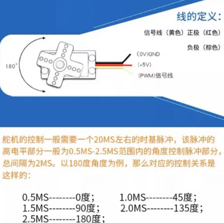
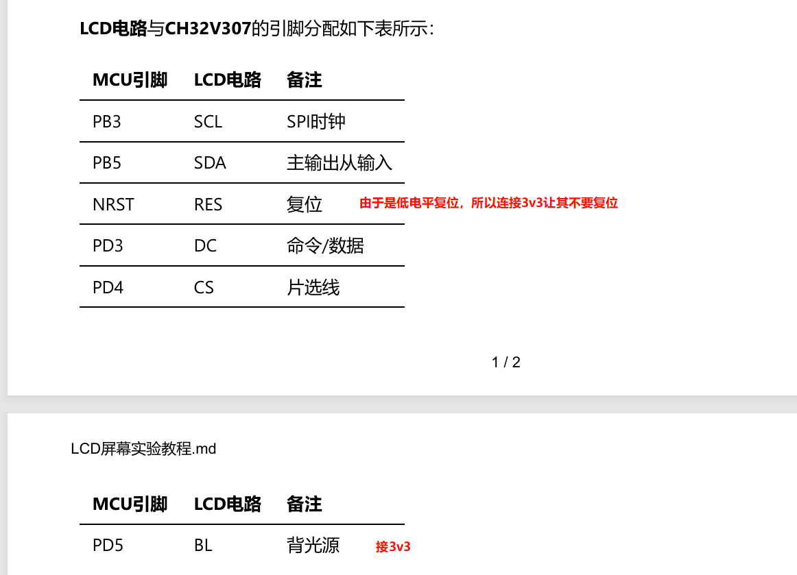
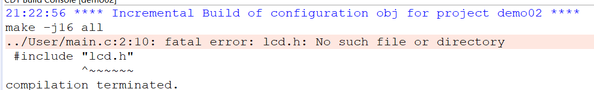
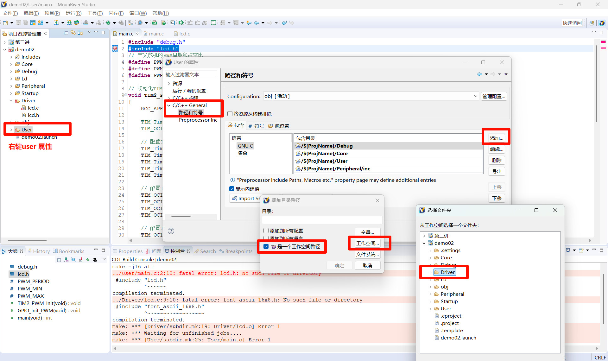

## SG90

### SG90舵机接线

**务必先进行共地，防止烧坏舵机和单片机。**

- `GND`：舵机的 `GND` 连接降压模块的 `GND`，同时降压模块的 `GND` 也要连接单片机的 `GND`
- 信号线：舵机的信号线连接单片机的 `PC2`
- `VCC`：舵机的 `VCC` 连接降压模块的 `5V`

### 验证接线是否正确

可以先不用定时器，直接使用 `GPIO` 手动输出高低电平，简单模拟 `PWM` 波形，用来验证舵机接线是否正确。

这样做的好处是排查更直接：如果舵机完全不动，优先检查供电、共地和信号线；如果会抖动但不稳定，再考虑脉宽是否合适。

### 使用定时器产生 PWM 波形

确认接线无误后，再移植 `PWM` 例程，使用定时器二输出更稳定的 `PWM` 波形。

这里的核心不是“有波形就行”，而是周期和脉宽要基本符合舵机要求。通常舵机控制信号是固定周期的脉冲，脉宽变化对应不同角度，因此定时器的分频和重装值要先算对，再去调角度。

## 屏幕

### TFT彩屏接线

- `GND` 接到降压模块 `GND`，降压模块 `GND` 再连接单片机 `GND`
- `VCC` 接到降压模块 `3.3V`
- 其余引脚连接如下

这里要特别注意供电电压。舵机一般使用 `5V`，而 TFT 彩屏通常使用 `3.3V`，两者不能混接；移植前最好先确认模块丝印和资料，避免直接上电把屏幕烧坏。

### 移植 LCD 时出现报错

这个报错是因为没有添加头文件和源码所在路径。

处理方法如下：

1. 右键 `User`，点击“属性”
2. 进入 `C/C++ General`
3. 点击“路径和符号”
4. 点击“添加”
5. 选择“工作空间路径”
6. 选择对应文件所在的文件夹
7. 补充：实际上路径格式应与前面的格式相同，即`/${ProjName}/Driver`，否则每次都得重新添加

如果路径已经加了还是报错，再检查两点：

- 头文件是否确实在工程可见目录下
- `.c` 文件是否也被加入到了工程中

很多时候不是驱动本身有问题，而是工程路径没配完整，导致编译器找不到对应文件。
